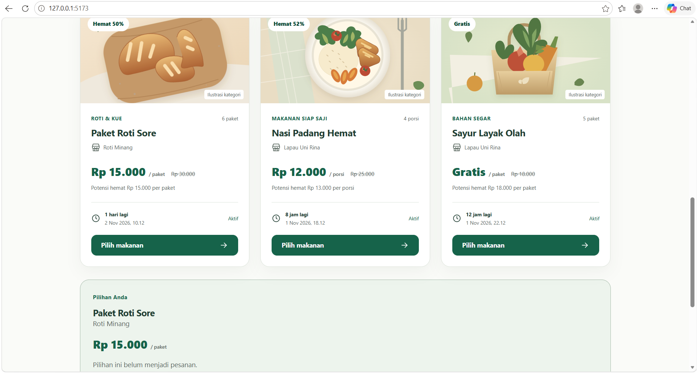
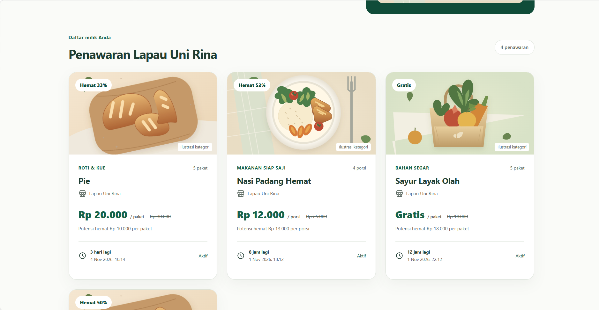

# SisaBaik - Chapter 9: Membangun Antarmuka dengan Vue

Repositori ini berisi implementasi antarmuka frontend untuk proyek **SisaBaik** menggunakan **Vue.js 3 (Composition API)** dan **Vite**, yang dikembangkan sebagai bagian dari modul pembelajaran chapter 9.

## 📋 Ringkasan Modul & Fitur Terimplementasi
- **Inisialisasi Proyek Vue 3**: Mengonfigurasi lingkungan pengembangan menggunakan Vite, Node.js, dan struktur direktori berbasis komponen (`src/components`, `src/assets`, `src/data`, `src/lib`).
- **Sistem Komponen Modular**: 
  - `Ikon.vue`: Komponen penampil ikon SVG lokal dinamis berbasis properti nama.
  - `App.vue`: Komponen utama pengelola state aplikasi (pencarian, filter kategori, mode pembeli vs penyedia, dan *timer* reaktif waktu kedaluwarsa).
- **Manajemen Aset SVG Lokal**: Integrasi ikon merek (`brand-mark.svg`) dan ilustrasi makanan (`food-bowl.svg`, `food-bread.svg`, `food-produce.svg`) dengan rendering yang bersih.
- **Interaktif & Reaktif**:
  - Filter pencarian nama dan kategori secara *real-time*.
  - Mode ganti tampilan antara **Pembeli** dan **Penyedia (Rina)**.
  - Formulir penambahan penawaran baru secara reaktif ke dalam daftar.

## 🛠️ Tech Stack
- **Framework**: Vue 3 (Composition API)
- **Bundler & Dev Server**: Vite
- **Styling**: *SisaBaik Design System* (CSS kustom responsif)

## ⚙️ Cara Menjalankan Proyek

1. Masuk ke direktori frontend:
   ```bash
   cd frontend

2. Instal dependensi:
npm install

3. Jalankan server pengembangan (development server):
npm run dev
Buka tautan lokal di peramban Anda (biasanya http://127.0.0.1:5173/).

4. Build Produksi & Preview
Untuk melakukan kompilasi bundel produksi dan mengujinya secara lokal:

# Membuat build produksi
npm run build

# Menjalankan preview hasil build
npm run preview
Hasil Uji Coba Skenario
- Mode Pembeli: Katalog, pencarian nama, dan pemilihan penawaran berhasil diuji serta dirender dengan baik.
- Mode Penyedia: Manajemen formulir penambahan penawaran dan pembaruan statistik reaktif berjalan lancar tanpa kendala.
- Aset & Ikon: Seluruh ikon SVG lokal serta ilustrasi makanan termuat sempurna di peramban.

## 📸 Tampilan Antarmuka Aplikasi

### 1. Tampilan Mode Pembeli (Memesan)


### 2. Tampilan Mode Penyedia (Menawarkan)
